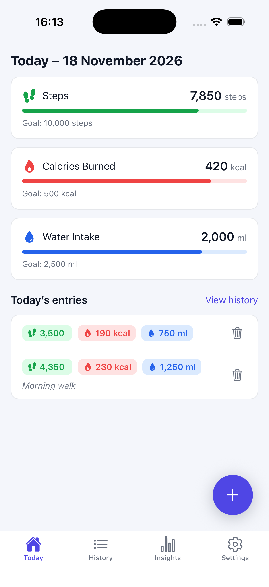
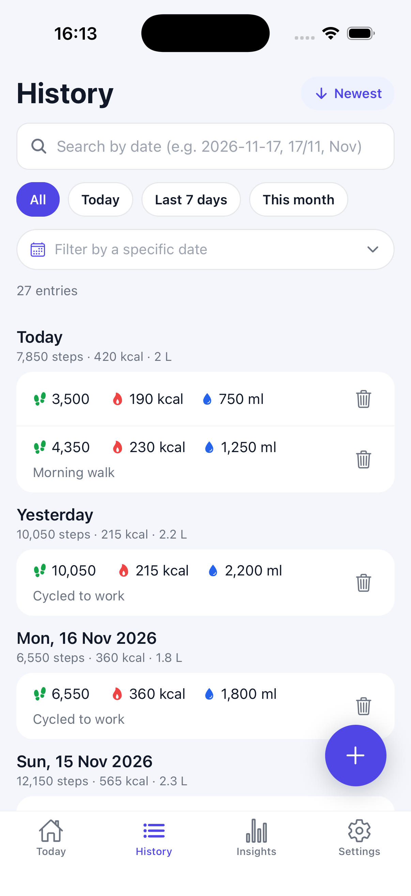
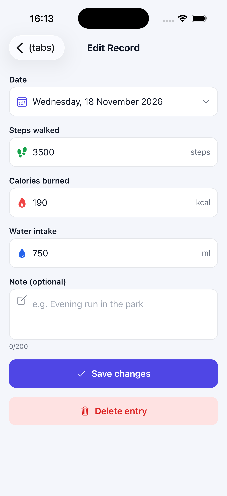
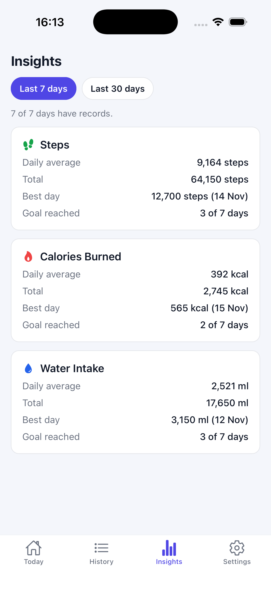
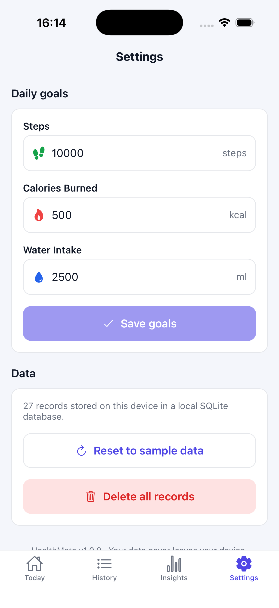
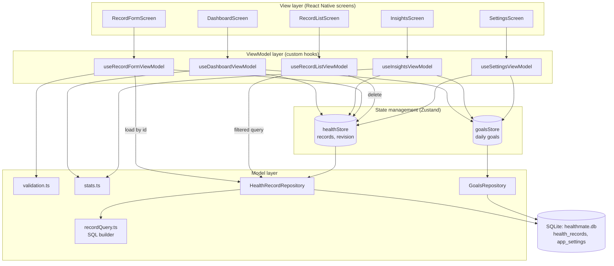

# 💚 HealthMate – Personal Health & Wellness Tracker

A cross-platform (iOS & Android) mobile app built with **React Native (Expo SDK 58)** and **TypeScript**.
It lets you record, manage, search and review your daily steps, calories burned and water intake.
All data is stored on the device in an embedded **SQLite** database.

| Dashboard | History | Edit record | Insights | Settings |
|---|---|---|---|---|
|  |  |  |  |  |

---

## 1. Features

### Core requirements
| Requirement | Where |
|---|---|
| Add daily health entries (steps, calories, water) | **Add Record** screen (`+` button) |
| View past records with dates | **History** tab – grouped by day with daily totals |
| Update / delete records | Tap an entry to edit it; trash icon or long-press to delete |
| Search / filter by date | History: free-text date search, quick filters, date picker, sort order |
| Summary dashboard | **Today** tab – today's totals for each metric |

### Extra features
- **Daily goals** – each dashboard metric shows a progress bar towards a goal (goals are editable in Settings and stored in SQLite).
- **Insights** tab – average, total, best day and goal-reached count for the last 7 or 30 days.
- Multiple entries per day are supported and summed (e.g. a morning walk and an evening run).
- **Reset to sample data** / **Delete all records** in Settings.
- Pull-to-refresh, empty/error/loading states, accessibility labels.

### Search syntax (History screen)
| You type | Matches |
|---|---|
| `2026-11-17` | that exact day |
| `2026-11` | every day in November 2026 |
| `17/11/2026` or `17.11.2026` | that exact day |
| `17/11` | 17 November in any year |
| `Nov`, `november`, `Nov 2026` | that month |

All searches are converted to **parameterised SQL** (`?` placeholders) so user input is never concatenated into a query.

---

## 2. Tech stack

| Concern | Choice | Why |
|---|---|---|
| Framework | React Native 0.88 + Expo SDK 58 | One TypeScript codebase for iOS and Android; runs in Expo Go |
| Language | TypeScript (strict) | Type-safe models, view models and repository |
| Navigation | Expo Router (file-based) | Tabs + modal stack, deep-linkable (`healthmate://record/12`) |
| State management | **Zustand** | Small, hook-based global stores; easy to test without React |
| Database ("backend") | **expo-sqlite** (embedded SQLite) | React Native equivalent of `sqflite`; works offline, no server needed |
| Date picker | @react-native-community/datetimepicker | Native Android dialog / iOS calendar |
| Testing | Jest (jest-expo) + React Native Testing Library | Unit, integration and component tests |
| Linting | ESLint (eslint-config-expo) | Includes React Hooks / React Compiler rules |

> **About the backend:** HealthMate is a local-first app. The "backend" is the on-device SQLite database accessed
> through a **Repository** layer. Because all data access goes through the `HealthRecordRepository` interface, a
> remote REST API could be added later by writing a second implementation without touching the UI.

---

## 3. Architecture – MVVM, feature-based

```
src/
├── app/                         # ROUTES ONLY (Expo Router). Thin wrappers that render feature screens.
│   ├── _layout.tsx              # Root stack + start-up (DB open/migrate, load stores)
│   ├── (tabs)/                  # Bottom tabs: index (Today), records, insights, settings
│   └── record/                  # new.tsx (modal), [id].tsx (edit)
├── core/                        # Shared, feature-agnostic code
│   ├── database/                # schema.ts, migrations.ts, seed.ts, database.ts (connection)
│   ├── components/              # Reusable UI: Button, Card, Chip, FormField, DateField, ProgressBar, EmptyState…
│   ├── hooks/                   # useAppBootstrap, useToday
│   ├── theme/                   # colours, spacing, typography, metric config (steps=green, calories=red, water=blue)
│   └── utils/                   # date + number formatting
├── features/
│   ├── health-records/
│   │   ├── model/               # MODEL: types, validation rules, statistics (pure functions)
│   │   ├── data/                # MODEL: repository (SQL CRUD) + query builder
│   │   ├── state/               # Zustand store (single source of truth for records)
│   │   ├── viewmodels/          # VIEWMODEL: useDashboardViewModel, useRecordListViewModel, useRecordFormViewModel
│   │   └── views/               # VIEW: DashboardScreen, RecordListScreen, RecordFormScreen + components
│   ├── goals/                   # Goals repository, store, settings view model + SettingsScreen
│   └── insights/                # Insights view model + screen
└── test-utils/                  # In-memory repository fake for tests
```

### Layers and responsibilities

| Layer | Responsibility | Knows about |
|---|---|---|
| **View** (`views/*.tsx`) | Renders UI, forwards user events. No business logic or SQL. | its ViewModel, shared components |
| **ViewModel** (`viewmodels/use*.ts`) | Screen state (form values, errors, filters), derived data, user actions | store, repository, model functions |
| **Store** (`state/*.ts`, Zustand) | App-wide state shared by screens (all records, goals); re-syncs after writes | repository interface |
| **Model** (`model/*.ts`) | Types, validation and statistics as pure, testable functions | nothing UI-related |
| **Repository** (`data/*.ts`) | All SQL; maps rows ↔ objects | SQLite connection |
| **Database** (`core/database`) | Connection, schema, migrations, seed data | expo-sqlite |

### Architecture diagram



### Data flow example – adding a record
1. The user fills in the form in `RecordFormScreen` (View).
2. `useRecordFormViewModel.submit()` runs `validateRecordForm()` (Model). Errors are shown under each field.
3. If valid, the ViewModel calls `healthStore.addRecord()` (State).
4. The store calls `repository.create()` → `INSERT INTO health_records …` (SQLite), then re-reads all records and bumps `revision`.
5. Every screen subscribed to the store (Dashboard, Insights) re-renders automatically; the History list
   re-runs its filtered SQL query because `revision` changed.

---

## 4. Database

Embedded SQLite file `healthmate.db`, created on first launch by `src/core/database/migrations.ts`.
Schema versions are tracked with `PRAGMA user_version`, so future schema changes can be added as migration steps.

### `health_records`
| Column | Type | Notes |
|---|---|---|
| `id` | INTEGER **PRIMARY KEY** AUTOINCREMENT | |
| `date` | TEXT NOT NULL | `YYYY-MM-DD` (sorts correctly as text); indexed |
| `steps` | INTEGER NOT NULL DEFAULT 0 | `CHECK (steps >= 0)` |
| `calories` | INTEGER NOT NULL DEFAULT 0 | kcal, `CHECK (calories >= 0)` |
| `water` | INTEGER NOT NULL DEFAULT 0 | millilitres, `CHECK (water >= 0)` |
| `note` | TEXT | optional (extra) |
| `created_at` / `updated_at` | TEXT | timestamps (extra) |

### `app_settings`
Key/value table (`key TEXT PRIMARY KEY, value TEXT`) used for the daily goals (stored as JSON).

### CRUD operations (`healthRecordRepository.ts`)
| Operation | SQL |
|---|---|
| Create | `INSERT INTO health_records (date, steps, calories, water, note) VALUES (?, ?, ?, ?, ?)` |
| Read all / filtered | `SELECT * FROM health_records WHERE date >= ? AND date <= ? … ORDER BY date DESC, id DESC` |
| Read one | `SELECT * FROM health_records WHERE id = ?` |
| Update | `UPDATE health_records SET date = ?, steps = ?, calories = ?, water = ?, note = ?, updated_at = datetime('now') WHERE id = ?` |
| Delete | `DELETE FROM health_records WHERE id = ?` |

### Dummy data
On first launch 21 days of realistic sample records are inserted (`seed.ts`, deterministic so results are reproducible).
Today's sample totals match the brief: **7,850 steps, 420 kcal, 2,000 ml** (split across two entries).
You can restore the sample data at any time from **Settings → Reset to sample data**.

---

## 5. Validation & error handling

| Field | Rule | Message |
|---|---|---|
| Date | required, valid `YYYY-MM-DD`, not in the future | "You can't log activity for a future date." |
| Steps | whole number, 0 – 100,000 (blank = 0) | "Steps must be a whole number…", "…looks too high" |
| Calories | whole number, 0 – 10,000 kcal | |
| Water | whole number, 0 – 10,000 ml | |
| Note | ≤ 200 characters | |
| Whole form | at least one metric > 0 | "Enter at least one activity value greater than zero." |
| Goals | whole number > 0, within the same limits | |

Errors appear after the first save attempt and then update live as the user fixes them.
Database errors are caught and shown as messages (start-up screen with **Try again**, form error banner, alerts on delete),
and the database layer also enforces non-negative values with `CHECK` constraints.

---

## 6. UI/UX
- Simple, flat layout: bordered cards, rounded inputs, 44pt+ touch targets, bottom tab bar, floating action button.
- Consistent colour coding everywhere: **steps = green 👣, calories = red 🔥, water = blue 💧** (`core/theme/theme.ts`).
- Numeric keypad for numbers, "Next" moves between fields, keyboard-avoiding forms.
- Native date pickers on both platforms; future dates are disabled.
- Destructive actions ask for confirmation.
- Screen-reader labels on icons, progress bars and list items.

---

## 7. Getting started

**Requirements:** Node.js 20+, and either the **Expo Go** app on a phone, an iOS Simulator (Xcode) or an Android emulator.

```bash
npm install
```

```bash
npm start
```

Then press `i` (iOS simulator), `a` (Android emulator), or scan the QR code with Expo Go.

### Scripts
| Command | What it does |
|---|---|
| `npm start` | Start the Expo dev server |
| `npm run ios` / `npm run android` | Start and open on a simulator/emulator |
| `npm test` | Run all Jest tests |
| `npm run test:coverage` | Tests with a coverage report |
| `npm run typecheck` | TypeScript check (`tsc --noEmit`) |
| `npx eslint .` | Lint |

---

## 8. Testing

**71 automated tests in 9 suites, all passing** (`npm test`).

| Suite | Type | What it covers |
|---|---|---|
| `core/utils/__tests__/date.test.ts` | Unit | Date parsing/validation (leap years), adding days, labels, number/water formatting |
| `core/database/__tests__/database.test.ts` | Unit | Dummy data (coverage, brief example, determinism), migrations create the required schema, idempotency |
| `health-records/model/__tests__/validation.test.ts` | Unit | All form and goal validation rules |
| `health-records/model/__tests__/stats.test.ts` | Unit | Daily totals, zero-filled series, progress, averages, best day |
| `health-records/data/__tests__/recordQuery.test.ts` | Unit | Date search parsing, SQL building, SQL-injection safety |
| `health-records/data/__tests__/healthRecordRepository.test.ts` | Unit (mocked DB) | Row mapping and every CRUD statement + parameters, not-found handling, transactional reset |
| `health-records/state/__tests__/healthStore.test.ts` | Integration | Store CRUD, revision bumping, error state |
| `health-records/viewmodels/__tests__/viewModels.test.tsx` | Integration | Filters, grouping, form ViewModel: validation, save, edit load, not-found |
| `health-records/views/__tests__/components.test.tsx` | Component | MetricCard rendering, RecordListItem rendering and press/delete events |

### Manual test cases (iPhone 17 Pro simulator, iOS 27)
M1, M2, M4 and M5 were run on the simulator; record results for the rest before submitting.

| # | Test | Steps | Expected | Result |
|---|---|---|---|---|
| M1 | First launch | Install & open app | DB created, sample data loaded, dashboard shows 7,850 / 420 / 2,000 ml | ✅ Pass |
| M2 | Add record – invalid | Open +, press Save with empty fields | "Enter at least one activity value…" banner | ✅ Pass |
| M3 | Add record – valid | Enter 500 in Water, Save | Returns to list; today's water becomes 2,500 ml | ⬜ To run |
| M4 | Search by date | History → type `15/11` | Only 15 Nov 2026 shown, "1 entry" | ✅ Pass |
| M5 | No results | Search an unknown date | "No matching records" + Clear filters | ✅ Pass |
| M6 | Edit record | Tap an entry, change steps, Save | List and dashboard update | ⬜ To run |
| M7 | Delete | Trash icon → Delete | Entry removed, totals update | ⬜ To run |
| M8 | Future date | Pick tomorrow in date picker | Not selectable | ⬜ To run |
| M9 | Goals | Settings → change step goal → Save | Dashboard progress recalculates | ⬜ To run |
| M10 | Insights | Switch between 7 and 30 days | Stats update | ⬜ To run |

---

## 9. Version control
The project uses Git. Suggested workflow: feature branches (`feature/history-search`, `feature/insights`…)
merged into `main`, with small descriptive commits (e.g. `feat(records): add date search`).
